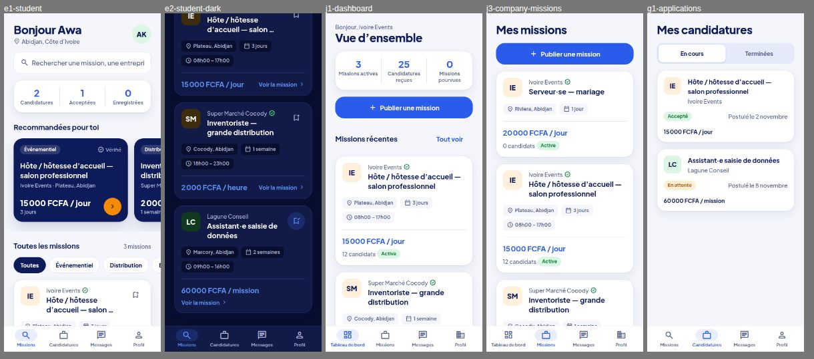

# Find

Application mobile et web de mise en relation entre étudiants et entreprises pour des missions courtes en Côte d'Ivoire. Ce dépôt contient le **frontend** (Expo SDK 58, React Native, Expo Router, TypeScript).

## Démarrer

```bash
npm install
npx expo start
```

| Commande | Rôle |
| --- | --- |
| `npx expo start` | serveur de développement (iOS, Android, web) |
| `npx expo lint` | lint |
| `npm run typecheck` | vérification TypeScript |
| `npx expo install <paquet>` | ajouter une dépendance compatible avec le SDK |

## Architecture

```
assets/
  brand/            sources vectorielles du logo (SVG) ; brand/splash = calques du splash animé
  images/           PNG générés depuis assets/brand (icône, splash, logo in-app)
src/
  app/              routes Expo Router — uniquement des écrans et des layouts
    _layout.tsx       police, providers, gardes de navigation, splash animé
    index.tsx         redirection selon l'état (onboarding / auth / rôle)
    onboarding.tsx    tutoriel de premier lancement (pages à faire glisser)
    (auth)/           welcome, sign-in, sign-up
    student/          onglets étudiant : missions, candidatures, messages, profil
    company/          onglets entreprise : tableau de bord, missions, messages, profil
    mission/[id].tsx  fiche mission ; mission/new.tsx : publication (entreprise)
    conversation/[id] fil de discussion
  components/
    brand/            logo, splash animé
    ui/               briques génériques : Button, TextField, Badge, Chip, Avatar,
                      SegmentedControl, Screen, Reveal, PressableScale, Icon…
    app-tabs(.web)    barre d'onglets native / web
  features/         code métier par domaine (auth, missions, messaging, profile, onboarding)
  services/         accès aux données : client HTTP + fonctions par ressource
  i18n/             traductions FR / EN et hook useI18n
  constants/        design tokens (theme.ts) et langage de mouvement (motion.ts)
  hooks/            hooks transverses (thème, schéma de couleurs)
  types/            modèles métier partagés
```

### Règles

- **Les routes restent fines.** Un fichier de `src/app/` assemble des composants ; la logique vit dans `features/` et `services/`.
- **Les écrans ne lisent pas les données directement.** Ils passent par `src/services/`. Aujourd'hui ces fonctions renvoient des données de démonstration ; brancher le backend revient à remplacer leur corps par `apiFetch` (`EXPO_PUBLIC_API_URL`).
- **Aucun texte en dur.** Toute chaîne visible passe par `t('clé')` ; `fr.ts` est la référence et TypeScript impose les mêmes clés dans `en.ts`.
- **Aucune couleur en dur.** Utiliser `useTheme()` et les tokens de `constants/theme.ts`, dérivés du logo. Une carte utilise `cardSurface(theme)`.
- **Tout élément tactile passe par `PressableScale`** (ou `Button`, `Chip`) : il réagit dès que le doigt se pose.

### Navigation

`src/app/_layout.tsx` protège chaque groupe avec `Stack.Protected` :

| Garde | Écrans accessibles |
| --- | --- |
| onboarding non vu | `onboarding` |
| onboarding vu, pas de session | `(auth)` |
| session étudiant | `student`, `mission/[id]` |
| session entreprise | `company`, `mission/[id]` |

Ces gardes sont côté client : elles organisent le parcours, elles ne remplacent pas le contrôle d'accès du backend.

### Ce qui est simulé pour l'instant

- La session et l'onboarding sont en mémoire (`features/auth/session-context.tsx`) : ils sont réinitialisés à chaque redémarrage.
- La connexion n'appelle aucun serveur ; les missions, candidatures et conversations viennent de `features/missions/mock-data.ts`.

## Design et mouvement



- **Police** : Plus Jakarta Sans, une famille par graisse (`Font.*`), chargée dans `src/app/_layout.tsx`.
- **Surfaces** : fond teinté, cartes blanches légèrement élevées. Le bleu marine et l'orange de la marque sont réservés aux mises en avant et à l'action.
- **Mouvement** (`constants/motion.ts`) : par défaut rien ne rebondit (`Springs.settle`, `Springs.press`). Le rebond (`Springs.pop`) est réservé à la confirmation d'un geste : favori, candidature envoyée.
- **Apparitions** : `Reveal` échelonne les blocs à l'ouverture d'un écran ; en « mouvement réduit », tout passe en fondu sans déplacement.
- **Splash animé** (`components/brand/animated-splash.tsx`) : prend le relais du splash natif, la loupe fait un clin d'œil puis « Fin » se déroule depuis elle. Un appui le passe.

## Logo

Les sources sont dans `assets/brand/`. Pour régénérer les PNG après une modification, rendre chaque SVG à la taille voulue (icône 1024 px, foreground Android 512 px, favicon 48 px) et remplacer le fichier correspondant dans `assets/images/`.

| Couleur | Hex |
| --- | --- |
| Bleu marine | `#0E1B5B` |
| Bleu | `#2A5BEA` |
| Bleu ciel | `#22A7F7` |
| Orange | `#F58A07` |
